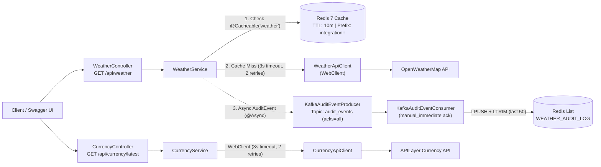

# External API Integration Service


A production-style **Spring Boot 3.5** backend service that integrates third-party **Weather (OpenWeatherMap)** and **Currency Exchange (APILayer)** APIs using reactive **Spring WebFlux `WebClient`**, **Redis** read-through caching, an asynchronous **Apache Kafka** audit pipeline, structured **`502 Bad Gateway` error handling**, and interactive **OpenAPI 3 / Swagger UI** documentation.

---

## Architecture & Request Flow



---

## Key Engineering Highlights

- **Resilient Reactive HTTP Clients (`WebClient`):**
  - Non-blocking HTTP calls to **OpenWeatherMap** and **APILayer Currency Data** with a **3-second timeout**, **2 automatic retries**, and upstream status checks that translate `4xx`/`5xx` responses into `ExternalApiException`.
- **Global Upstream Error Handling (`502 Bad Gateway`):**
  - `GlobalExceptionHandler` (`@RestControllerAdvice`) intercepts `ExternalApiException` and returns a clean, structured `ErrorResponse` record (`status`, `error`, `message`, `timestamp`) with HTTP `502 Bad Gateway`.
- **Redis Read-Through Caching & Custom Serialization:**
  - `WeatherService` caches responses per city via `@Cacheable(value = "weather", key = "#city")` with a **10-minute TTL**, `integration::` key prefix, null-value protection, Lettuce connection pooling, and a custom `GenericJackson2JsonRedisSerializer` configured with `JavaTimeModule`.
- **Non-Blocking Kafka Audit Pipeline with Failure Isolation:**
  - Every uncached weather lookup asynchronously publishes an `AuditEvent` (`@Async` `CompletableFuture`) to the `audit_events` topic (`acks=all`, `retries=3`).
  - `KafkaAuditEventConsumer` consumes events with `manual_immediate` offset acknowledgment and stores a bounded rolling audit trail (last 50 events via `LPUSH` + `LTRIM 0 49`) under the `WEATHER_AUDIT_LOG` key in Redis.
  - Downstream Kafka errors are isolated in `WeatherService` so broker outages never break user-facing API responses.
- **Interactive OpenAPI 3 / Swagger UI Documentation:**
  - Configured via `springdoc-openapi-starter-webmvc-ui` (`v2.8.14`) and `OpenApiConfig` with `@Operation`, `@ApiResponses`, `@Parameter`, and `@Schema` annotations across all controllers and DTOs.

---

## API Documentation (Swagger)

After starting the application, access Swagger UI at:

http://localhost:8080/swagger-ui/index.html

*(Also accessible via the short redirect `http://localhost:8080/swagger-ui.html`, or on port `8081` when running via Docker Compose: `http://localhost:8081/swagger-ui/index.html`.)*

Use Swagger UI to explore and test:
- **Weather API** (`GET /api/weather?city=Kathmandu`)
- **Currency Exchange API** (`GET /api/currency/latest?base=USD&symbols=EUR,NPR`)

The application must be running locally to execute API requests. Raw OpenAPI 3.0 JSON specification is available at `/v3/api-docs`.

---

## API Endpoints

| Method | Endpoint | Query Parameters | Description |
| :--- | :--- | :--- | :--- |
| `GET` | `/api/weather` | `city` *(required, e.g. `Kathmandu`)* | Fetches current temperature & humidity from OpenWeatherMap (cached in Redis for 10 min + publishes async Kafka audit event) |
| `GET` | `/api/currency/latest` | `base` *(default: `USD`)*, `symbols` *(optional, e.g. `EUR,NPR`)* | Fetches live currency exchange rates from APILayer |
| `GET` | `/swagger-ui/index.html` | — | Interactive Swagger UI API explorer |
| `GET` | `/v3/api-docs` | — | Raw OpenAPI 3.0 JSON specification |
| `GET` | `/actuator/health` | — | Application, Redis, and Kafka health indicators |
| `GET` | `/actuator/prometheus` | — | Micrometer / Prometheus metrics scrape endpoint |

### Sample Responses

**`GET /api/currency/latest?base=USD&symbols=EUR,NPR` (`200 OK`)**
```json
{
  "success": true,
  "source": "USD",
  "date": null,
  "quotes": {
    "USDEUR": 0.904601,
    "USDNPR": 150.811136
  }
}
```

**`GET /api/weather?city=Kathmandu` (`200 OK`)**
```json
{
  "main": {
    "temp": 293.15,
    "humidity": 64
  }
}
```

**Upstream API Error (`502 Bad Gateway`)**
```json
{
  "status": 502,
  "error": "Bad Gateway",
  "message": "Weather API failed",
  "timestamp": "2026-11-14T00:40:00"
}
```

---

## Project Structure

```text
external-api-integration/
├── src/main/java/com/company/Integration/
│   ├── Client/
│   │   ├── CurrencyApiClient.java        # WebClient for APILayer Currency API (timeout + retry)
│   │   └── WeatherApiClient.java         # WebClient for OpenWeatherMap API (timeout + retry)
│   ├── Config/
│   │   ├── OpenApiConfig.java            # OpenAPI 3 / Swagger UI metadata configuration
│   │   ├── RedisConfig.java              # RedisTemplate + Jackson JavaTimeModule serializer
│   │   ├── WeatherConfig.java            # @ConfigurationProperties for weather WebClient
│   │   └── WebClientConfig.java          # Shared WebClient bean
│   ├── Controller/
│   │   ├── CurrencyController.java       # REST controller for /api/currency/latest
│   │   └── WeatherController.java        # REST controller for /api/weather
│   ├── DTO/
│   │   ├── CurrencyResponse.java         # Currency rate response DTO (@JsonProperty("quotes"))
│   │   ├── ErrorResponse.java            # Standardized 502 error record
│   │   └── WeatherResponse.java          # Weather temperature & humidity DTO
│   ├── Exception/
│   │   ├── ExternalApiException.java     # Custom unchecked upstream failure exception
│   │   └── GlobalExceptionHandler.java   # @RestControllerAdvice mapping to 502 Bad Gateway
│   ├── Kafka/
│   │   ├── AuditEvent.java               # Kafka event payload (eventType, description, timestamp)
│   │   ├── KafkaAuditEventConsumer.java  # @KafkaListener with manual ack + Redis LPUSH/LTRIM
│   │   └── KafkaAuditEventProducer.java  # @Async CompletableFuture Kafka publisher
│   ├── Service/
│   │   ├── CurrencyService.java          # Currency business service
│   │   └── WeatherService.java           # @Cacheable Redis weather service + Kafka audit trigger
│   └── IntegrationApplication.java       # @EnableCaching + @EnableAsync entry point
├── src/main/resources/
│   ├── application.yaml                  # Server, Kafka, Redis, WebClient, Actuator & SpringDoc config
│   └── application-local.properties.example # Template for local API keys (safe for Git)
├── src/test/java/com/company/Integration/
│   └── ExternalApiUnitTests.java         # JUnit 5 + Mockito unit tests for both APIs & error handler
├── Dockerfile                            # Multi-stage Eclipse Temurin 17 Alpine build
└── docker-compose.yml                    # Redis 7, Apache Kafka 3.8 (KRaft), and Spring Boot service
```

---

## Getting Started

### 1. Clone the Repository
```bash
git clone https://github.com/pablo483/external-api-integration.git
cd external-api-integration
```

### 2. Configure API Keys
Copy the example properties file to `application-local.properties` (which is git-ignored so your keys stay private):
```bash
cp src/main/resources/application-local.properties.example src/main/resources/application-local.properties
```
Fill in your keys in `src/main/resources/application-local.properties` (or in a root `.env` file for Docker Compose):
```properties
CURRENCY_API_KEY=your_apilayer_currency_api_key
WEATHER_API_KEY=your_openweathermap_api_key
```

### 3. Run Locally with Maven (Port `8080`)
```bash
./mvnw spring-boot:run
```
Then open Swagger UI at: **http://localhost:8080/swagger-ui/index.html**

### 4. Run with Docker Compose (Port `8081` — Includes Redis 7 & Kafka 3.8)
```bash
docker compose up --build -d
```
- **Swagger UI:** http://localhost:8081/swagger-ui/index.html
- **Health Check:** http://localhost:8081/actuator/health

---

## Running Unit Tests

Run the unit test suite (`ExternalApiUnitTests`) covering `WeatherController`, `WeatherService`, `WeatherApiClient`, `CurrencyController`, `CurrencyService`, `CurrencyApiClient`, Kafka failure isolation, and `GlobalExceptionHandler`:

```bash
./mvnw test -Dtest=ExternalApiUnitTests
```

---

## Author

**Sudarshan GC** — [GitHub](https://github.com/pablo483) • [sudarshangc580@gmail.com](mailto:sudarshangc580@gmail.com)
